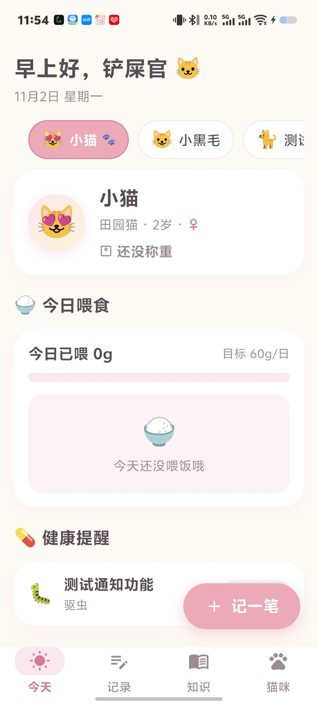
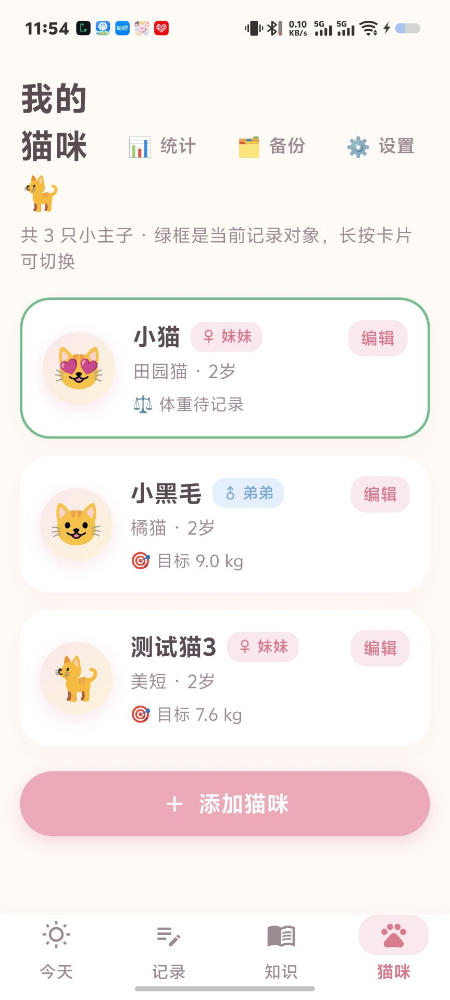
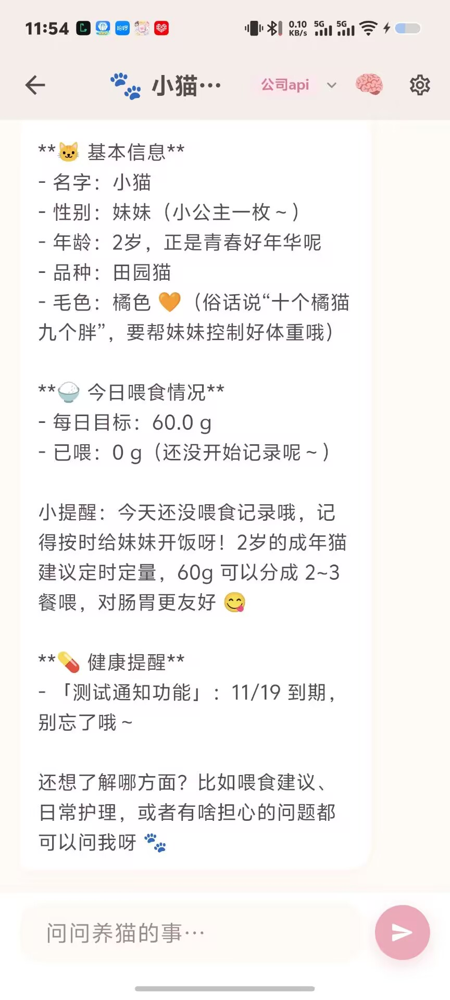
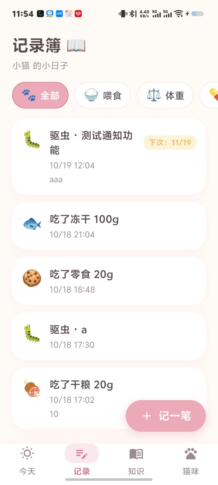
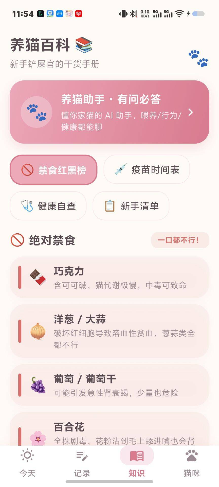

<div align="center">


# eCAT · Meow Butler

**A cute, local-first cat care companion — every cat gets its own profile, every memory stays on your device**

[](https://github.com/lvliang666666/ecat/releases)
[](LICENSE)
[](https://www.android.com/)
[](https://www.microsoft.com/windows/)
[](https://flutter.dev/)

English | [简体中文](README.zh-CN.md)

[⬇️ Download](#-download) · [✨ Features](#-feature-overview) · [🔧 Tech Highlights](#-tech-highlights) · [🛠 Build from Source](#-build-from-source)

</div>

---

## 💡 Why eCAT

Most pet apps bury you in accounts, ads and cloud sync you never asked for. Caring for a cat should be simple: feed, weigh, remember the vet date — and move on with your day.

**eCAT (喵喵管家 / Meow Butler) is my answer**: a cream-and-pink, paw-print-sprinkled cat care app built around one core idea — **one cat, one profile**. Every feeding log, weight curve, vaccine reminder and even the AI chat context is isolated per cat, so a multi-cat household never mixes things up. All data lives in local storage on your device. No account, no cloud, no telemetry.

From the first line of code to v1.7, one person handled product design, development, testing and releases — backed by a strict [versioning workflow](VERSIONING.md) and a living feature backlog. This is not a demo; it is a seriously maintained product.

## ✨ Core Highlights

- 🐾 **One cat, one profile** — cats are the center of everything: switch a cat, and the whole app switches with it (records, weight curve, reminders, even the AI assistant's conversation)
- 🍚 **Effortless daily logging** — a three-in-one quick-entry sheet (feed / weight / health) with one-tap common amounts; big buttons, minimal typing
- ⏰ **Reminders that actually fire** — vaccine & deworming due dates, daily feeding time, and cat birthdays (3 days ahead + the day itself) via local notifications; missed events are re-delivered on next launch
- 📈 **Weight curve with a goal line** — fl_chart-powered trend with your cat's target weight as a dashed reference, plus weekly "gained 0.2 kg 🎉" reports
- 🤖 **A cat-expert AI assistant** — bring your own OpenAI-compatible API key; it knows the current cat's profile, today's feeding and due reminders, and remembers facts across sessions
- 🌙 **Dark mode & haptics everywhere** — a warm night palette, and every tap gives a soft squeeze-and-buzz feedback (custom-drawn nav bar included)

## 📱 Screenshots

| Today | Cat Profiles | Cat Detail |
|:---:|:---:|:---:|
|  |  |  |
| **Records** | **Knowledge** | |
|  |  | |

## 📥 Download

Grab the latest build from the [**Releases page**](https://github.com/lvliang666666/ecat/releases/latest):

1. **Android**: download `ecat-vX.Y.Z-android.apk` and install (allow "install unknown apps" when prompted)
2. **Windows**: download `ecat-vX.Y.Z-windows.zip`, unzip and run `ecat.exe`
3. On first launch, a 3-page onboarding walks you through creating your first cat profile

> Requires Android 5.0 (API 21) or above / Windows 10 or above.

## ✨ Feature Overview

| Module | Capabilities |
|---|---|
| 🐱 Cat Profiles | Name / breed / birthday / gender / neutered / coat color / emoji or photo avatar / target weight / allergies / notes; auto-calculated cat age |
| 🍚 Feeding | 5 food types (dry / wet / freeze-dried / treats / water) + grams + notes; personalized daily goal per cat with a progress bar on Home |
| ⚖️ Weight | Same-day dedup, 0–30 kg fixed axis, last-7 trend curve with target dashed line, full history view |
| 🏥 Health | Vaccine / deworming / bath / vet / symptom logs with next-due dates; color-coded countdown (overdue red / today yellow / upcoming green) |
| ⏰ Reminders | Health due-date alerts (09:00 on due day), daily feeding reminder with custom time, cat birthday reminders (3 days ahead + the day); boot-completed restore + missed-event re-delivery with dedup |
| 📖 Records | Merged reverse-chronological timeline, type filter chips, long-press to edit or delete |
| 📊 Stats | Weekly / monthly feeding totals, weekly weight report |
| 🤖 AI Assistant | OpenAI-compatible `/chat/completions` with SSE streaming; multiple saved API configs with one-tap switching; per-cat conversation context; long-term memory (auto-extracted, globally shared, manageable) |
| 💾 Data | One-tap JSON export / import — move to a new phone with everything intact |
| 🎨 Experience | 3-page onboarding, dark mode (follow system / light / dark), paw-celebration animation on save, global haptic feedback, photo avatars |
| 📚 Knowledge | 17-item food safety red/yellow/green list, vaccine schedule, 6 self-check guides, 10-item new-cat checklist with progress |

## 🔧 Tech Highlights

| | |
|---|---|
| **Cat-centric data isolation** | Every record carries a `catId`; deleting a cat cascades through its logs, reminders and AI conversation — no orphan data, ever |
| **Reliable local notifications** | `flutter_local_notifications` + `timezone`: Android uses `inexactAllowWhileIdle` (no exact-alarm permission needed) and daily-repeat matching; Windows pre-schedules a rolling 7-day window; `RECEIVE_BOOT_COMPLETED` restores schedules after reboot; missed events are re-delivered on launch with SP-flag dedup |
| **R8-safe release builds** | Core library desugaring + keep rules for the notification plugin (`com.dexterous.**`, gson) — verified via `mapping.txt` that receivers keep their original names, avoiding the classic "notifications silently die in release" trap |
| **SSE streaming assistant** | Hand-rolled OpenAI-compatible client with typewriter rendering; system prompt injects the current cat's profile, today's feeding and due reminders; lightweight post-chat memory extraction |
| **Custom haptic system** | A `CuteTap` wrapper (press-scale 0.96 + `HapticFeedback.selectionClick`) applied across all interactive components; Material components that swallow gestures (nav bar, FAB) were re-drawn from scratch to keep feedback consistent |
| **Engineered workflow** | Batch-based iteration + SemVer + Conventional Commits + acceptance ledger: every feature is traceable to its requirement and acceptance record (39 tests kept green) |

## 🛠 Build from Source

```bash
# 1. Requirements: Flutter SDK (Dart SDK >= 3.12.2), Android SDK / Windows desktop toolchain
git clone https://github.com/lvliang666666/ecat.git
cd ecat

# 2. Fetch dependencies
flutter pub get

# 3. Run tests (optional, 39 cases)
flutter test

# 4. Build release APK (Android)
flutter build apk --release
# Output: build/app/outputs/flutter-apk/app-release.apk

# 4'. Build release exe (Windows)
flutter build windows --release
# Output: build/windows/x64/runner/Release/ecat.exe
```

> Note (Windows): Developer Mode must be enabled, otherwise plugin symlink creation fails and `flutter build windows` silently hangs. On Chinese networks, set `PUB_HOSTED_URL=https://pub.flutter-io.cn` and `FLUTTER_STORAGE_BASE_URL=https://storage.flutter-io.cn`.

## 🗺 Roadmap (Planned)

The [feature backlog](docs/ROADMAP.md) is intentionally empty right now — new ideas are evaluated and parked there before being scheduled.

> Scope promise: this README only describes features that are **implemented and accepted**. Planned items are never oversold.

## ⚠️ Disclaimer

- The AI assistant ships with **no model service** — bring your own API key; usage and costs are charged by your chosen provider, not this project
- AI-generated content may be wrong; for health issues, always consult a veterinarian
- Provided "as is" under the MIT license — see [LICENSE](LICENSE)

## 🤝 Contributing

Bug reports and feature suggestions are welcome via [Issues](https://github.com/lvliang666666/ecat/issues). Given the strict versioning and acceptance workflow, please open an Issue to discuss before large PRs.

## ⭐ Support

If eCAT helps you and your cats, a **Star** ⭐ means the world to a solo developer — and helps more cat parents discover this project.

---

<div align="center">

**eCAT · Meow Butler** — One cat, one profile, all memories yours 🐾

</div>
