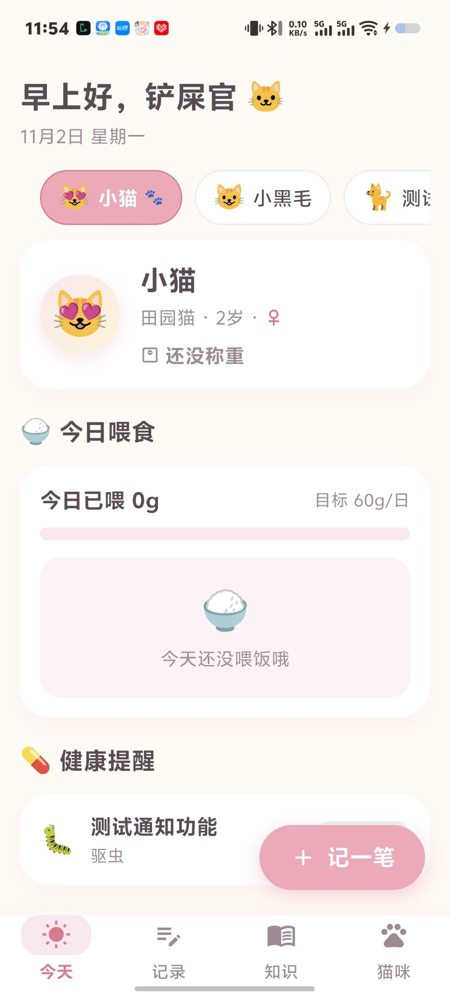
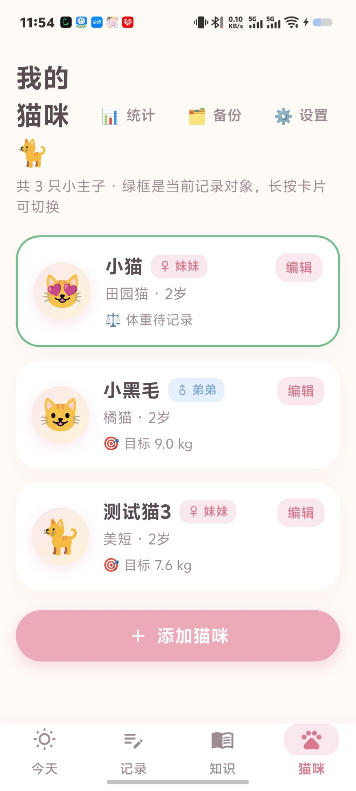
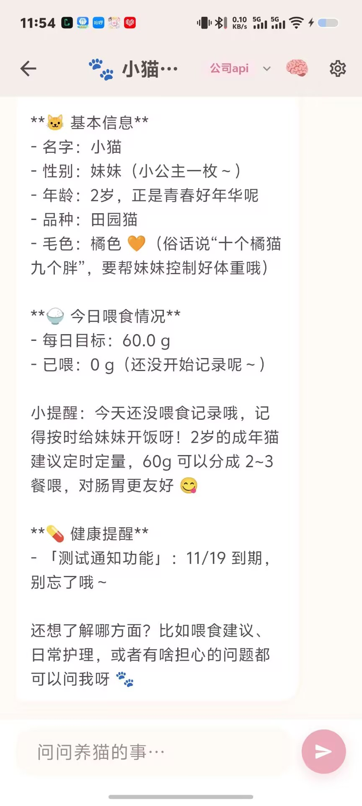
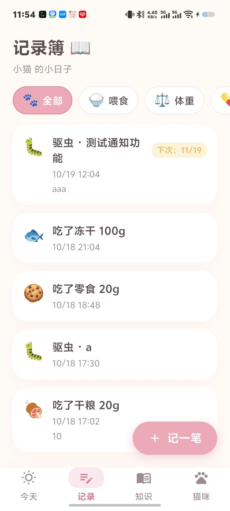
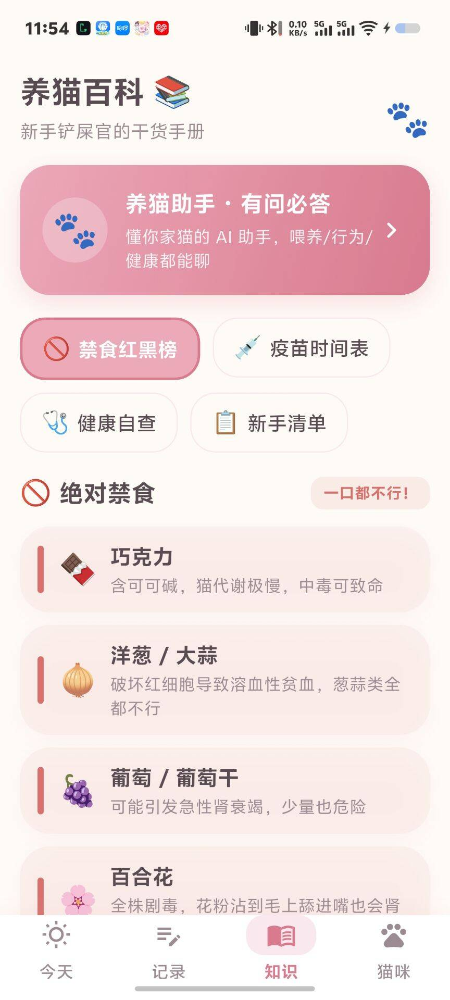

<div align="center">


# eCAT · 喵喵管家

**可爱风、本地优先的养猫管家 —— 一猫一档，所有记忆都留在你手里**

[](https://github.com/lvliang666666/ecat/releases)
[](LICENSE)
[](https://www.android.com/)
[](https://www.microsoft.com/windows/)
[](https://flutter.dev/)

[English](README.md) | 简体中文

[⬇️ 下载](#-下载) · [✨ 功能总览](#-功能总览) · [🔧 技术亮点](#-技术亮点) · [🛠 从源码构建](#-从源码构建)

</div>

---

## 💡 为什么做 eCAT

主流宠物 App 总是把你塞进账号体系、广告和从没要求过的云同步。照顾一只猫本该很简单：喂了、称了、记住疫苗日期——然后继续过自己的日子。

**eCAT（喵喵管家）就是我的答案**：一款奶油白 + 樱花粉、撒满猫爪元素的养猫 App，围绕一个核心设计——**一猫一档**。每条喂食记录、每条体重曲线、每个疫苗提醒、甚至 AI 助手的对话上下文，都按猫隔离。多猫家庭永远不会串数据。所有数据都存在你设备本地：没有账号、没有云端、没有遥测。

从第一行代码到 v1.7，一个人完成了产品设计、开发、测试和发布——背后有严格的[版本管理规范](VERSIONING.md)和持续维护的需求池。这不是一个 demo，而是一个认真维护的产品。

## ✨ 核心亮点

- 🐾 **一猫一档** —— 猫咪是一切的中心：切换猫咪，整个 App 跟着切换（记录、体重曲线、提醒、连 AI 助手的对话都各聊各的）
- 🍚 **轻松记一笔** —— 喂食/体重/健康三合一快捷弹窗，常用量一键点选；大按钮、少打字
- ⏰ **真的会响的提醒** —— 疫苗/驱虫到期、每日喂食时间、猫咪生日（提前 3 天 + 当天）本地通知；错过的提醒下次启动自动补发
- 📈 **带目标线的体重曲线** —— fl_chart 绘制趋势，目标体重虚线参考，还有「这周胖了 0.2kg 🎉」周报
- 🤖 **懂猫的 AI 助手** —— 自备 OpenAI 兼容 API Key；它知道当前猫的档案、今日喂食和到期提醒，还能跨会话记住事实
- 🌙 **深色模式 + 全局触动反馈** —— 暖夜色调色板；每一次点按都有轻缩放 + 震动反馈（自绘底栏也不例外）

## 📱 应用截图

| 今天 | 猫咪管理 | 猫咪详情 |
|:---:|:---:|:---:|
|  |  |  |
| **记录簿** | **养猫知识** | |
|  |  | |

## 📥 下载

前往 [**Releases 页面**](https://github.com/lvliang666666/ecat/releases/latest) 获取最新版本：

1. **Android**：下载 `ecat-vX.Y.Z-android.apk` 安装（提示时允许「安装未知应用」）
2. **Windows**：下载 `ecat-vX.Y.Z-windows.zip`，解压后运行 `ecat.exe`
3. 首次启动有 3 页引导，带你创建第一份猫咪档案

> 需要 Android 5.0（API 21）及以上 / Windows 10 及以上。

## ✨ 功能总览

| 模块 | 能力 |
|---|---|
| 🐱 猫咪档案 | 名字/品种/生日/性别/绝育/毛色/emoji 或照片头像/目标体重/过敏禁忌/备注；猫龄自动计算 |
| 🍚 喂食 | 5 类食物（干粮/湿粮罐头/冻干/零食/饮水）+ 克数 + 备注；每猫独立每日目标，首页进度条 |
| ⚖️ 体重 | 同日去重、0–30kg 固定纵轴、最近七次趋势曲线带目标虚线、历史体重查看 |
| 🏥 健康 | 疫苗/驱虫/洗澡/就医/症状记录 + 下次到期时间；倒计时三色（过期红/今天黄/未来绿） |
| ⏰ 提醒 | 健康到期提醒（到期日 09:00）、每日喂食提醒（时间可调）、猫咪生日提醒（提前 3 天 + 当天）；开机恢复 + 错过补发去重 |
| 📖 记录簿 | 三类记录合并时间线倒序、类型筛选胶囊、长按编辑/删除 |
| 📊 统计 | 周/月喂食量统计、体重周报 |
| 🤖 AI 助手 | OpenAI 兼容 `/chat/completions` + SSE 流式打字机；多套 API 配置一键切换；每猫独立会话上下文；长期记忆（自动提取、全局共享、可管理） |
| 💾 数据 | 一键 JSON 导出/导入——换手机数据完整带走 |
| 🎨 体验 | 3 页首次引导、深色模式（跟随系统/浅色/深色）、保存成功猫爪庆祝动效、全局触动反馈、照片头像 |
| 📚 养猫知识 | 17 条禁食红黄绿榜、疫苗时间表、6 条健康自查、10 条可勾选新手清单 |

## 🔧 技术亮点

| | |
|---|---|
| **以猫为中心的数据隔离** | 每条记录都带 `catId`；删除猫咪级联清理其所有记录、提醒和 AI 会话——永远不留孤儿数据 |
| **可靠的本地通知** | `flutter_local_notifications` + `timezone`：Android 用 `inexactAllowWhileIdle`（免精确闹钟权限）+ 每日重复匹配；Windows 预排未来 7 天滚动窗口；`RECEIVE_BOOT_COMPLETED` 开机恢复排定；错过的事件启动补发并用 SP 标记去重 |
| **R8 混淆安全** | Core library desugaring + 通知插件 keep 规则（`com.dexterous.**`、gson），并用 `mapping.txt` 验证 Receiver 原名保留——避开「release 包通知静默失效」的经典坑 |
| **SSE 流式助手** | 手写 OpenAI 兼容客户端 + 打字机渲染；系统提示词注入当前猫档案、今日喂食与到期提醒；对话后轻量提取记忆 |
| **自绘触动反馈体系** | `CuteTap` 组件（按压缩放 0.96 + `HapticFeedback.selectionClick`）覆盖全部可交互组件；吞手势的 Material 组件（底栏、FAB）直接自绘替换，保证反馈一致 |
| **工程化流程** | 批次制迭代 + SemVer + Conventional Commits + 验收台账：每个功能都能追溯到需求与验收记录（39 个测试保持全绿） |

## 🛠 从源码构建

```bash
# 1. 环境要求：Flutter SDK（Dart SDK >= 3.12.2）、Android SDK / Windows 桌面工具链
git clone https://github.com/lvliang666666/ecat.git
cd ecat

# 2. 拉取依赖
flutter pub get

# 3. 跑测试（可选，39 个用例）
flutter test

# 4. 构建 Android APK
flutter build apk --release
# 产物：build/app/outputs/flutter-apk/app-release.apk

# 4'. 构建 Windows exe
flutter build windows --release
# 产物：build/windows/x64/runner/Release/ecat.exe
```

> 注意（Windows）：必须开启开发者模式，否则插件符号链接创建失败、`flutter build windows` 静默卡死。国内网络请设置 `PUB_HOSTED_URL=https://pub.flutter-io.cn` 和 `FLUTTER_STORAGE_BASE_URL=https://storage.flutter-io.cn`。

## 🗺 规划中

[需求池](docs/ROADMAP.md)目前有意保持为空——新想法会先评估再入池排期。

> 范围承诺：本 README 只描述**已实现且验收过**的功能，规划中的内容绝不过度宣传。

## ⚠️ 免责声明

- AI 助手**不附带任何模型服务**——请自备 API Key；用量与费用由你选择的服务商收取，与本项目无关
- AI 生成的内容可能有误；健康问题请务必咨询兽医
- 按 MIT 协议「原样」提供——见 [LICENSE](LICENSE)

## 🤝 参与贡献

欢迎通过 [Issues](https://github.com/lvliang666666/ecat/issues) 反馈 Bug 和功能建议。鉴于本项目有严格的版本管理与验收流程，大型 PR 请先开 Issue 讨论。

## ⭐ 支持一下

如果 eCAT 帮到了你和你的猫，一个 **Star** ⭐ 对独立开发者意义重大——也能让更多猫家长发现这个项目。

---

<div align="center">

**eCAT · 喵喵管家** —— 一猫一档，所有记忆都留在你手里 🐾

</div>
